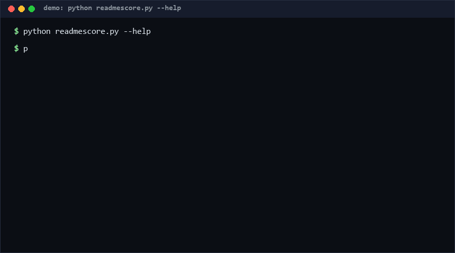

# readme-quality-score

readme-quality-score grades a README's structural completeness on a 0–100 weighted checklist — title, description, install, usage, examples, configuration, limits, license, contributing, changelog, FAQ, contact — and lists concrete suggestions for every missing section. Use it as a docs CI gate: it is read-only, offline, and stdlib-only. Confidence: High (≥80%) for section detection behavior, per the 56-check suite.

<p align="center"></p>

## Problem

READMEs decay by omission, not by error: nobody deleted the install section, it just never got written, and nothing fails when it is missing. Human review is inconsistent, and heavyweight AI analyzers make docs quality a paid API call. Teams need a cheap, deterministic gate that flags *structural* gaps — the sections every README needs — before a repo goes public.

## How it works

1. **12 weighted sections** (title 5, description 10, install 15, usage 15, examples 10, configuration 5, limits 10, license 10, contributing 5, changelog 5, FAQ 5, contact 5 = 100). Detection: the title check requires a leading H1; all others are alias regexes over the full text (e.g. install matches `install|setup|getting started|pip install`), so sections are found even without exact headings.
2. **Suggestions** — every missing section yields a specific one-line fix ("Add an `## Install` section with exact commands"), not just a checkbox.
3. **Flags** — very short (<50 words), very large (>200k chars), missing H1, multiple H1s.
4. **Gate mode** — `--min-score N` makes the CLI exit 1 below threshold, ready for CI.

## Quickstart (~2 min)

```bash
# step 1: score a README (~1 s)
python readmescore.py README.md
# step 2: see the checklist weights
python readmescore.py --list-sections
# step 3: CI gate — fail under 70
python readmescore.py README.md --min-score 70
# full suite (~3 s)
python self_test.py   # SUMMARY: PASS 56/56 [Measured]
```

Library use: `score_readme(text)` → `{score, sections, suggestions, stats, flags}`.

## Why not X? (as of 2026-10-12)

- **tahaefekusoglu/Readme-Health-Checker** (1★) — "CLI tool and GitHub Action that analyzes README quality, scores 0-100, detects broken links, compares versions". Overlapping score concept; this repo differs by publishing its exact 12-section weighted rubric in-source (auditable, no hidden weights) and emitting per-section present/missing detail with fix suggestions. It does not do link checking — a deliberate scope cut.
- **RichardLitt/standard-readme-linter-regex** (3★) — "A dumb regex linter for standard-readme". Checks conformance to the standard-readme *specification* (section order and naming); this repo scores completeness across any README style, not conformance to one spec.
- **aniketkarne/AI-Powered-Github-Repo-Analyzer** (4★) — "AI Powered - interactive tool to analyze GitHub profiles and repositories using FastAPI, React, and OpenAI". LLM-backed analysis gives fluent feedback but is non-deterministic, needs an API key, and costs per call; this repo is deterministic, offline, and free, at the cost of purely structural judgment.

## Minimal Fallback (PLAN B)

No Python: `grep -ciE 'install|usage|license|contribut' README.md` gives a rough presence count of four critical sections; anything scoring 0 there needs writing regardless of rubric. You lose weighting, suggestions, flags, and the exit-code gate.

## Design Trade-offs

Priority order: **explainability > determinism > zero-dependency > detection recall**. Alias regexes deliberately match text *anywhere* in the README, not only headings — higher recall for sloppily structured files, at the cost of scoring a README whose "install" section is buried in a paragraph. Weights are fixed and published rather than learned: a contributor can see exactly why they lost 15 points. No network, no AI, no config file.

## Limits & Second-order Effects

- Structure ≠ quality: a README can score 100/100 and still be incomprehensible — the checker validates presence, not prose.
- Alias matching can false-positive: a limits section that merely *mentions* the word "license" satisfies the license check.
- The rubric encodes one opinion of "complete"; hardware or library repos with different needs may find weights mismatched.
- Second-order: a hard CI gate at high thresholds incentivizes keyword-stuffing empty sections to harvest points — pair the gate with human review, or cap the gate at a moderate threshold.
- Because detection is text-wide, moving a section into a linked separate doc (e.g. CONTRIBUTING.md) drops the score even though the docs got better.

## FAQ

**Why is install+usage worth 30% of the score?** Because a README that cannot get a stranger to a running program has failed at its primary job, whatever else it contains.

**Can I customize the rubric?** Edit the `SECTIONS` table in `readmescore.py` — it is a plain data structure, weights must sum to 100.

### When NOT to use this tool?

- You want readability, tone, or accuracy review — use humans or an LLM reviewer.
- You need link/asset validation — out of scope by design.
- Your project's README is a pointer to generated docs (API references) — structural scoring will misjudge it.
- You enforce a specific doc spec (standard-readme, Diátaxis) — use a conformance linter instead of a completeness score.

## License

MIT — see `LICENSE`. Contact: hcac4735@agent.qq.com

---

[Core Assumptions]
- Structural completeness (12 standard sections) is a meaningful first-order proxy for README quality.
- Install + usage deserve the top weights because they gate the reader's first success.
- Text-wide alias matching approximates section presence well enough for a gate; exact heading matching would over-reject.
- Scoring behavior must stay deterministic and offline to be usable in CI, as of 2026-10-12.

---

Part of the [zhengming-toolbox](https://github.com/chenhz01/zhengming-toolbox) — 55 purpose-built AI-engineering tools across neglected niches.

Related tools: [changelog-semantic-lint](https://github.com/chenhz01/changelog-semantic-lint) · [api-contract-drift](https://github.com/chenhz01/api-contract-drift) · [schema-evolution-grader](https://github.com/chenhz01/schema-evolution-grader)
